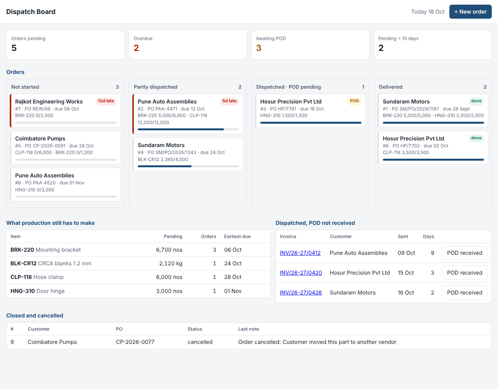
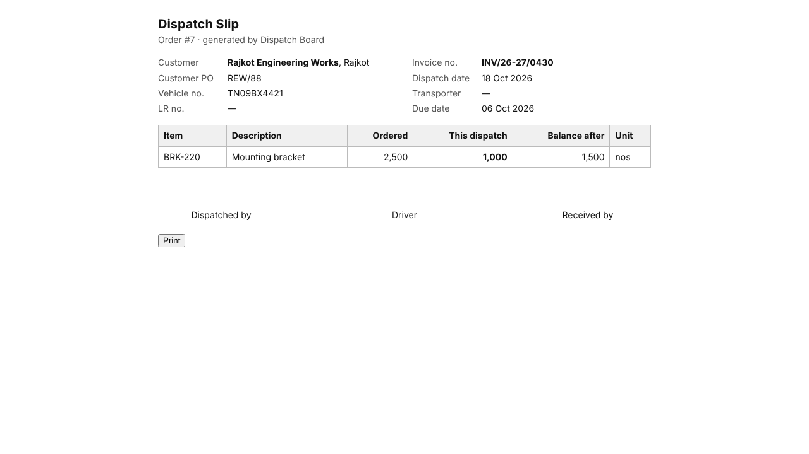

# Dispatch Board

An order-to-delivery board for a manufacturer that ships in part-loads. It answers the questions the owner asks the dispatch in-charge every day:

- Which orders are late, and by how much?
- What's left to send on each order — and what does production still have to make?
- Which trucks have gone but we don't have the POD yet (so we can't chase payment)?



## What it does

- **Board by stage:** not started → partly dispatched → dispatched (POD pending) → delivered. Overdue orders are marked with how many days late.
- **Part dispatches:** each truck is recorded against the order's lines with invoice, vehicle, transporter and LR number. The order shows sent / pending per item.
- **"What production still has to make":** pending quantity per item across all open orders, sorted by the earliest due date. This is the list the production planner actually needs.
- **POD tracking:** an order is only *delivered* when proof of delivery is back for every truck.
- **Printable dispatch slip** for each truck, with the balance after that dispatch.
- **History on every order:** quantity changes, short-closes, dispatches and PODs, in plain words.



## The exceptions, and how it handles them

| Situation | Rule |
|---|---|
| Sending more than ordered | Blocked, with the exact allowance ("only 1500 nos can go — ordered 2500, already sent 1000") |
| Customer accepts a little extra (material sold by weight, cut lengths) | Per-order **tolerance %** (up to 20%); the allowance includes it |
| One truck with several items, one of them wrong | The whole dispatch is rejected and every problem is listed; nothing is half-saved |
| Customer revises the PO quantity | Allowed with a reason and logged — but never below what's already been sent |
| Customer doesn't want the balance | **Short-close** the balance with a reason. It stops showing as pending and can't be dispatched against |
| Cancel an order that's partly shipped | Not allowed — short-close instead, so the shipped part isn't lost from the records |
| Same customer PO entered twice | Rejected (case- and space-insensitive). A *different* customer may use the same PO number |
| Same invoice number used twice | Rejected |
| Dispatch dated in the future, or before the order date; POD before dispatch | Rejected |
| Vehicle number typed `tn 09 ab 1234` | Stored as `TN09AB1234` so the same truck matches across entries |
| Reprinting an old slip after later trucks went | The slip shows the balance as it was after *that* truck, not today's balance |
| Server runs in UTC, plant is in India | "Today" is the plant's date (`PLANT_TZ`, default `Asia/Kolkata`). Found while testing in a browser at 2 AM IST: the browser said 18 Oct, the server said 17 Oct, and a dispatch dated today was rejected as "in the future". |

## Run it

```bash
pip install -r requirements.txt
python -m dispatch.seed                 # sample orders dated relative to today
uvicorn dispatch.api:app --reload       # open http://127.0.0.1:8000
python -m pytest -q                     # 27 tests
```

API docs at `/docs`. Main endpoints:

| | |
|---|---|
| `GET /api/board` | columns, pending items, aging, overdue, awaiting POD |
| `POST /api/orders` | new order |
| `POST /api/orders/{id}/dispatches` | record a truck: `{"invoice_no": "...", "lines": {"BRK-220": 1500}, ...}` |
| `POST /api/orders/{id}/amend` · `/short-close` · `/cancel` | changes, each needs a reason |
| `POST /api/dispatches/{id}/pod` | proof of delivery received |
| `GET /dispatches/{id}/slip` | printable slip |

## Deploy (free)

`render.yaml` sets this up as a free web service on [Render](https://render.com): in the Render dashboard choose **New → Blueprint** and pick this repo. Free services sleep after 15 minutes without visitors and take about a minute to wake up. The disk isn't kept between restarts, so each start loads fresh sample orders again.

## Design

```
dispatch/
  db.py          SQLite schema: customers, orders, order_lines, dispatches, dispatch_lines, order_events
  services.py    all business rules (no HTTP), every function takes `today` so tests are deterministic
  api.py         FastAPI routes + the printable slip
  seed.py        sample data
  static/index.html   the board, no build step
```

Order status is **derived**, not stored: it's worked out from ordered, short-closed and dispatched quantities and the POD dates every time. There's no status field that can drift out of sync with what actually happened.

## Open questions for a real customer

- Do they invoice per truck, or one invoice across trucks? (Here it's one invoice per dispatch.)
- Do customers send schedules (daily call-offs against an open PO) rather than fixed orders? Many auto OEMs do, and that changes "pending".
- Who confirms POD today — the transporter, the driver's photo on WhatsApp, the customer's GRN? That decides how POD should be captured.
- Should this connect to the inventory tracker so a dispatch can't exceed finished-goods stock?
